# Banners in Hero Banner Slider for Magento 2

A banner is one image, with optional link and overlay content. Banners are reusable: one banner can be a hero on one page and a slide in several sliders. Open **Content, CoullWorks Banner Slider, Banners**.

## The Banners grid

*The Banners grid: ID, name and an Action column, with Add new Banners at the top.*

The grid has the standard Magento toolbar: **Filters**, a **Default View** bookmark menu, **Columns**, and paging. There is no keyword search box and no mass actions.

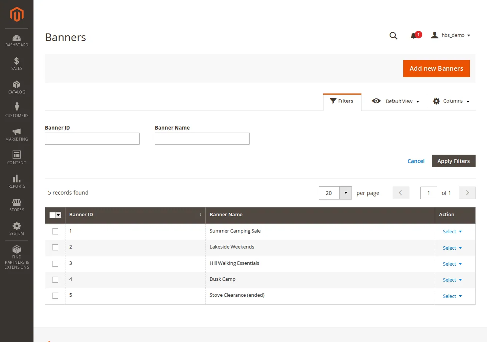

*Filters lets you search by banner ID and name.*

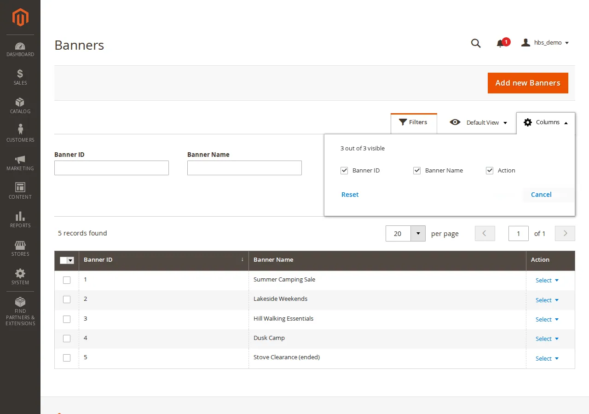

*Columns shows or hides each column and changes their order.*

## Add new Banners

The orange **Add new Banners** button opens an empty [banner form](#the-banner-form).

## Selection column

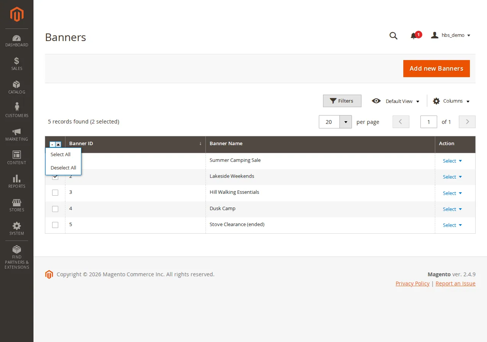

*The checkbox column selects rows. No mass actions are defined, so it only supports the standard select menu.*

## Banner ID

The banner's number. It is the sort column by default and has a text filter. Widgets, sliders and Page Builder store this number, so a banner keeps working when you rename it.

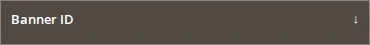

*Banner ID, sorted ascending.*

## Banner Name

The name you gave the banner, with a text filter. It can be edited in place, see [inline edit](#inline-edit).

## Actions: edit and delete

The **Select** menu on each row has **Edit** and **Delete**. Delete asks for confirmation and names the banner.

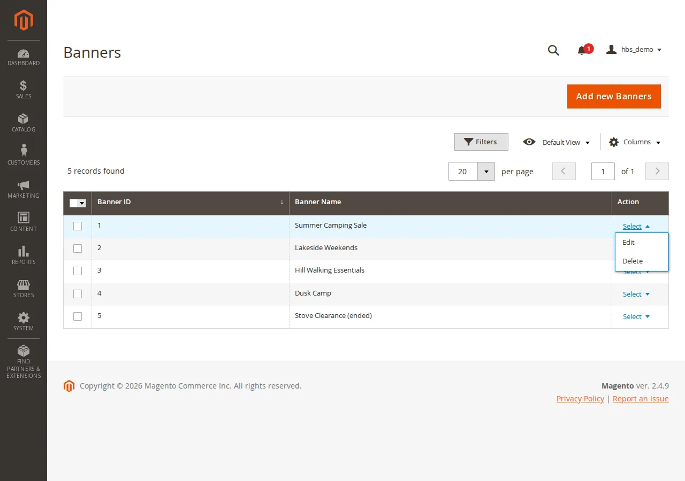

*Edit and Delete in the row menu.*

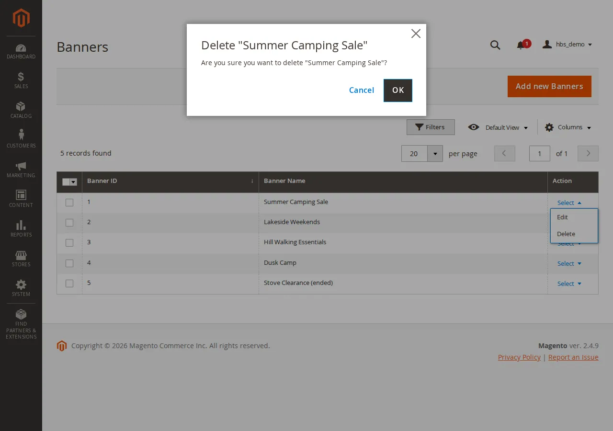

*The delete confirmation names the banner so you know which one you are removing.*

## Inline edit

Click a row to edit its name in the grid. Press **Save** to store it. Only the banner name can be changed this way. Use the form for anything else.

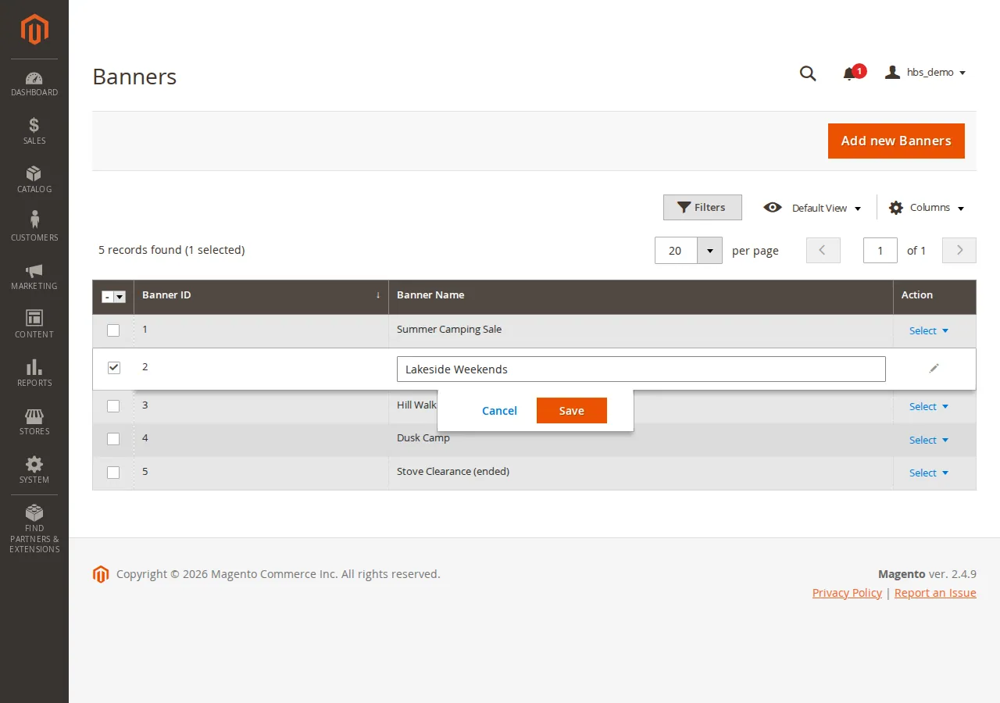

*A row in inline edit mode with the name field open.*

## The banner form

Press **Add new Banners**, or **Edit** on a row. The form has two groups: **General** (enabled, link, name and both images) and **Content** (the overlay).

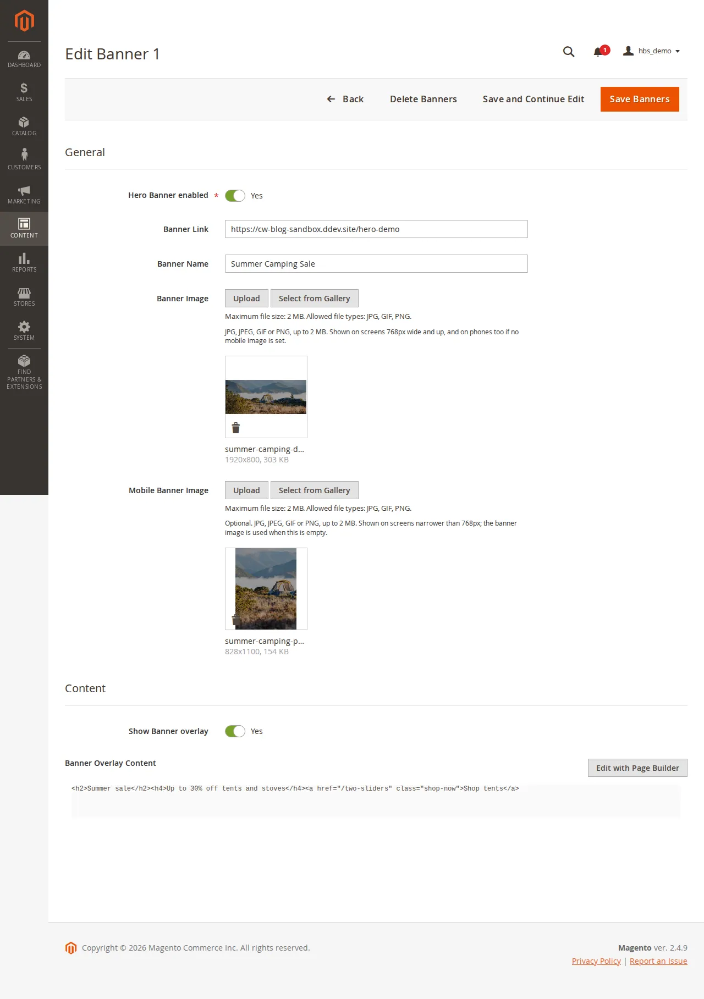

*The Edit Banners form for the Summer Camping Sale banner.*

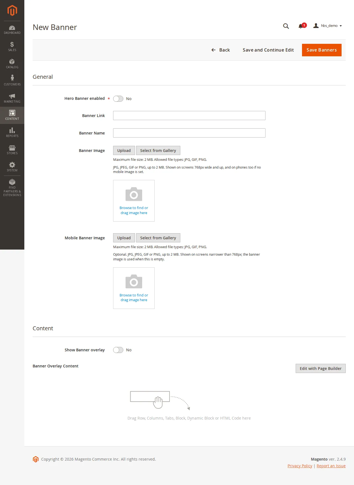

*A new banner, with nothing filled in.*

## Hero Banner enabled

Required. A Yes or No switch. A banner set to No renders nothing, wherever it is placed: as a hero it is blank, and inside a slider it is skipped and the other slides carry on. Use it to take a banner off the site without deleting it or editing every page that places it.

*Hero Banner enabled, set to Yes.*

## Banner Name

Not required, but fill it in. The name is also the image's alt text, the link's title attribute, the label on the slider's tabs, and the label in the pickers for widgets, Page Builder and the slider's slides list.

*Banner Name.*

## Banner Link

Not required. When set, the whole banner, image and overlay together, becomes one link to that address. The link opens in the same window. There is no setting for a new tab.

*Banner Link.*

When a banner has a Banner Link and its overlay also contains a link or button, the module makes the banner link a stretched link behind the overlay. Clicking the banner goes to the Banner Link and clicking the button goes to the button's own address, so both work. Before 2.1.1 the browser broke the layout in this case.

## Banner Image

The desktop image. JPG, JPEG, GIF or PNG, up to 2 MB. It is shown at 768 pixels wide and up, and on phones too if no phone image is set. See [Images](images.md) for the sizes and WebP handling.

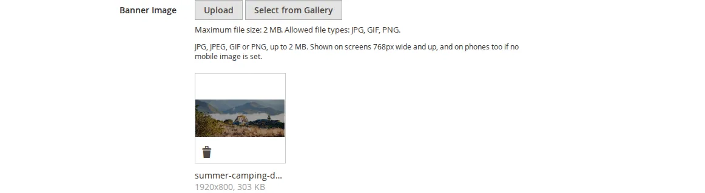

*Banner Image: Upload and Select from Gallery, the file rules, and the uploaded 1920 by 800 image.*

## Mobile Banner Image

Optional. Same file rules. Shown below 768 pixels wide. When it is empty the desktop image is used on phones as well.

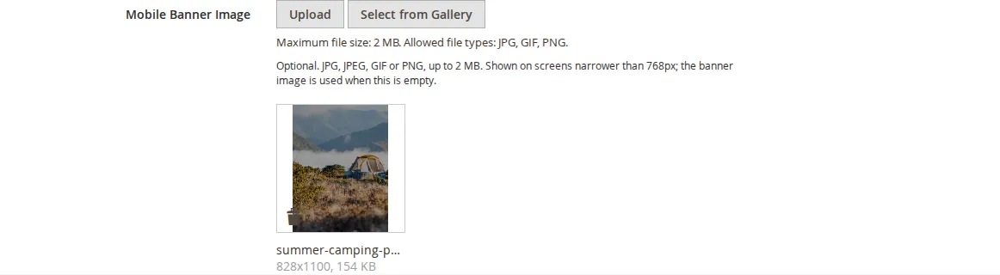

*Mobile Banner Image with a portrait phone image uploaded.*

## Show Banner overlay

A Yes or No switch. When Yes, the overlay content is drawn over the image. When No the content is kept but not shown.

*Show Banner overlay.*

## Banner Overlay Content

A WYSIWYG editor for the text over the image: headings, copy and buttons. It supports **Add Variable**, **Add Widget** and **Add Image** like any Magento editor, and you can open it in **Edit with Page Builder**. Headings and text scale down on phones.

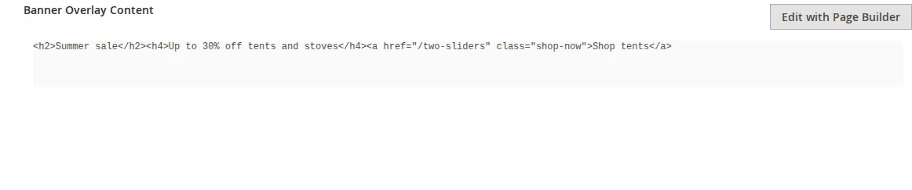

*The overlay editor holding a heading and a sub heading.*

## The buttons

| Button | What it does |
|---|---|
| **Back** | Returns to the grid. Unsaved changes are lost |
| **Delete Banners** | Only on an existing banner. Asks first, then removes it |
| **Save and Continue Edit** | Saves and stays on the form |
| **Save Banners** | Saves and returns to the grid |

*The four buttons at the top of the form.*

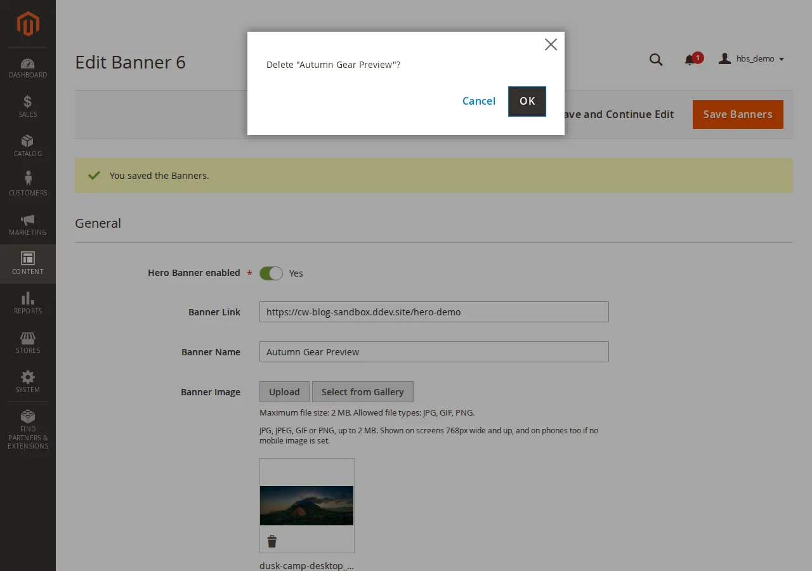

*Deleting from the form asks first and names the banner, as the grid does.*

A banner that is deleted while a slider still lists it is skipped on the storefront.

## Messages

The admin shows these messages. The wording says "Banners" rather than "Banner".

| Message | When |
|---|---|
| You saved the Banners. | A save worked |
| You deleted the Banners. | A delete worked |
| This Banners no longer exists. | You opened a banner that was deleted |
| Something went wrong while saving the Banners. | A save failed. The error is logged |
| We can't find a Banners to delete. | You deleted a banner that was already gone |

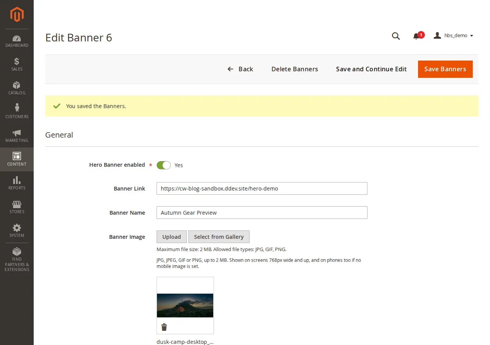

*The save message.*

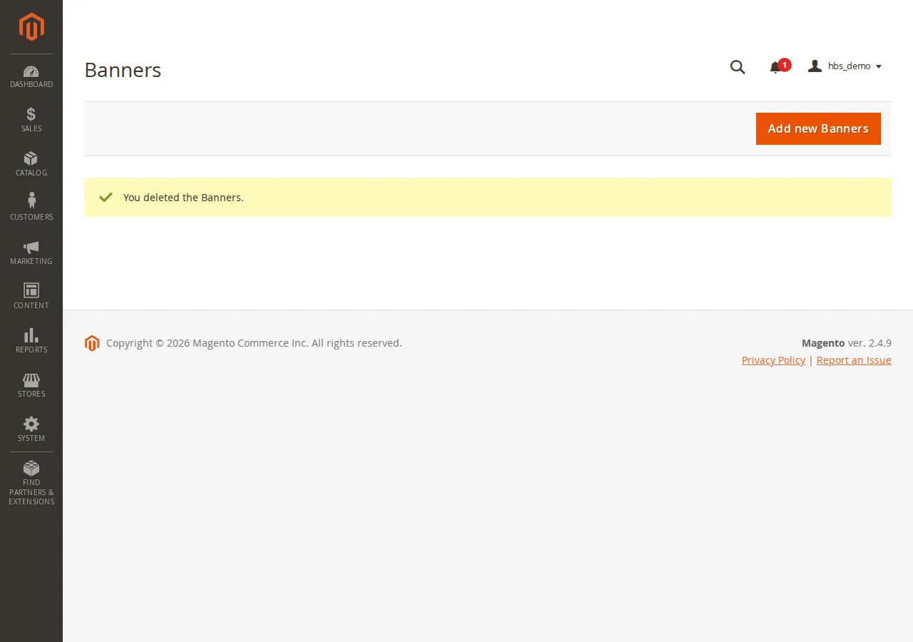

*The delete message.*
