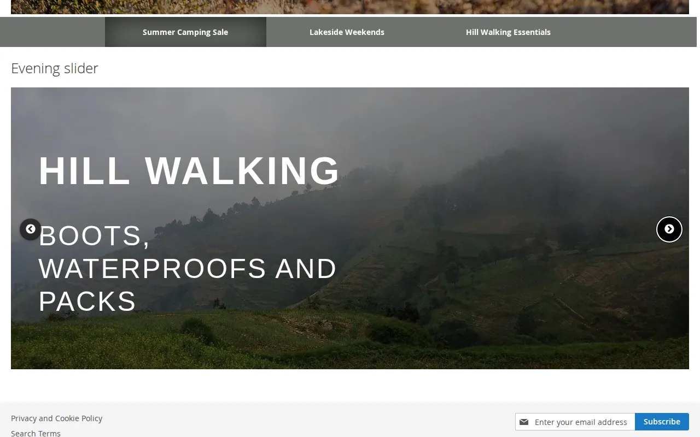
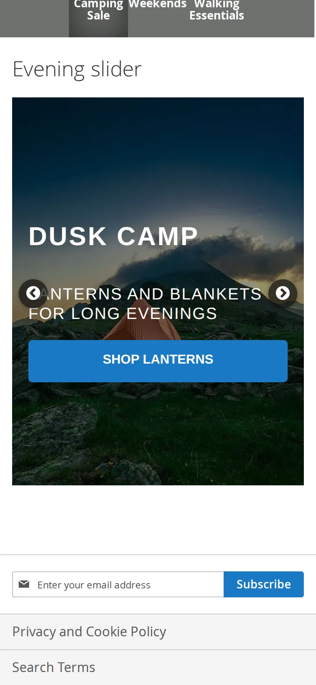
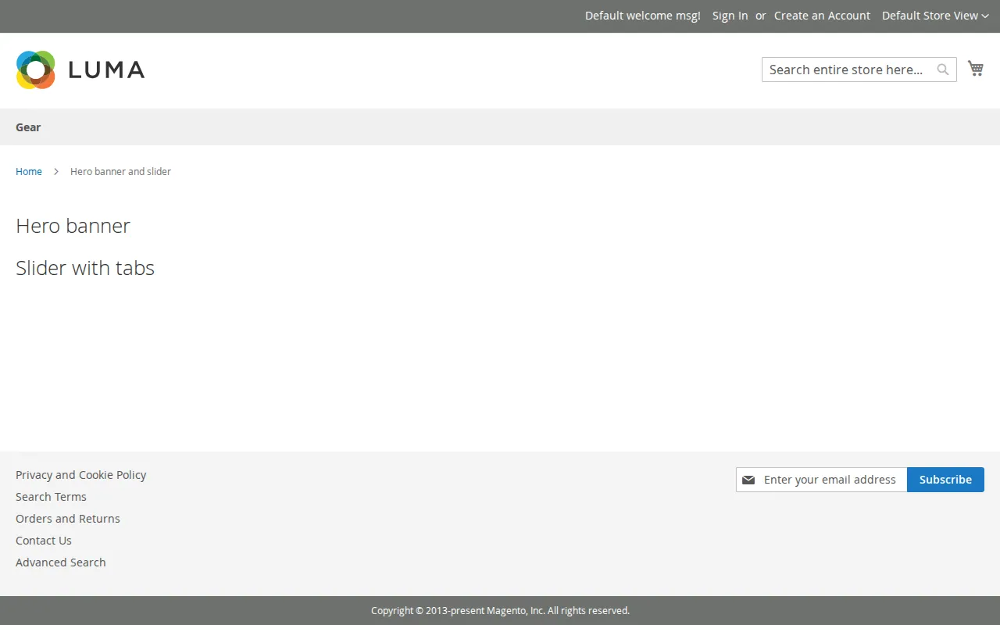

# How Hero Banner Slider behaves on the storefront

## The slider is fixed

The slider uses the Slick carousel with settings you cannot change in the admin:

| Behaviour | Value |
|---|---|
| Slides shown at once | 1 |
| Autoplay | On, every 4500 ms |
| Transition | Fade |
| Arrows | On, unless tabs are shown |
| Dots | Off |

*The slider with arrows, below the tabs strip of another slider.*

*On a phone the arrows are 36 pixels wide and sit closer to the edge.*

The arrows sit inside the slider on a dark round button with a white arrow, 40 pixels wide (36 on a phone), so they read on a light page and over dark photographs. They have a hover state and a visible focus ring for keyboard users.

If you need different behaviour, that is a custom development job.

## Tabs

With **Show Tabs under banner** on, a second strip lists each slide's name. It shows four names at once, centres the active one and follows the slider. Clicking a tab shows that slide, and the arrows are off.

*The tabs strip at desktop.*

*The tabs strip at 390 pixels.*

## Parallax

With Parallax on, the image sits in a 500 pixel high box and moves against the scroll. It runs on heroes and, from 2.1.0, on sliders too.

*The image offset has changed as the page scrolled.*

## Two sliders on one page

Each hero and slider gets its own id, so you can place as many as you like. Arrows and tabs on one move only that one. Before 2.1.0 they shared selectors and interfered.

*Two sliders on one page at desktop.*

*The same page at phone width.*

## When nothing renders

| Case | Result |
|---|---|
| Enable is No in the configuration | Nothing, for every placement |
| Banner missing or disabled | Nothing for a hero. Skipped inside a slider |
| Slider missing or disabled | Nothing |
| Slider with no enabled banners | Nothing |
| Banner has a link | The image and overlay are one link |

*The disabled state: the headings remain and the banners are gone.*

A banner that is switched off is not offered in a slider's Slides list, and a banner disabled after it was added drops out of the list the next time the slider is saved. It never shows on the storefront.

## Accessibility

The image alt text and link title are the banner name. Images decode asynchronously. The slider autoplays and cannot be paused or switched off, and it does not read the reduced motion preference. If that matters for your audience, use a single Hero Banner instead.
