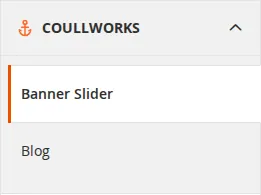
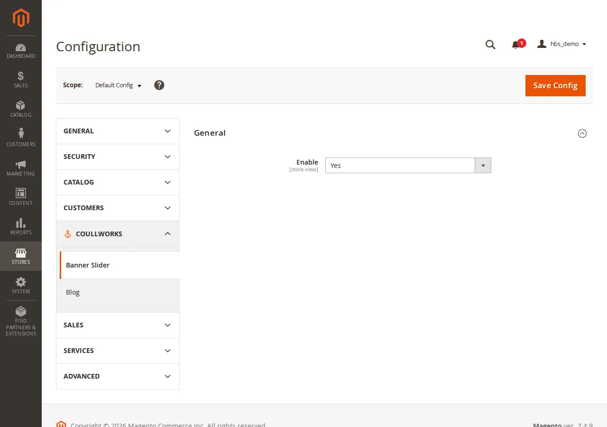
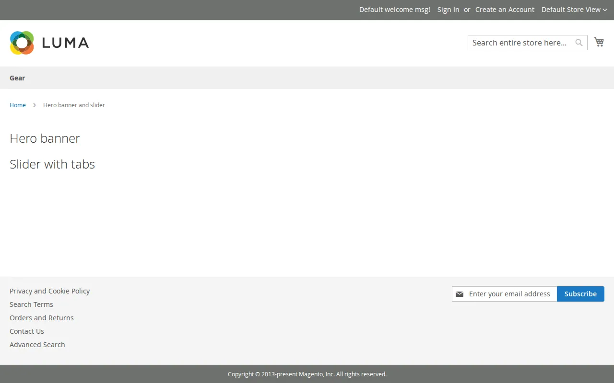

# Configure Hero Banner Slider for Magento 2

The module has a single store configuration setting. Banners and sliders are managed in their own grids, and placement options are set on each widget or Page Builder element.

## The CoullWorks tab

Go to **Stores, Configuration**. In the left tab list, **CoullWorks** is a shared tab that all CoullWorks modules use.

*The CoullWorks tab, with the CoullWorks logo, in the configuration menu.*

## The Banner Slider section

Under CoullWorks, open **Banner Slider**. It opens a page with one group, **General**.

*The Banner Slider section as it opens. Only the General group is present.*

## The General group

*General holds one field.*

## Enable

Config path `banner_slider/general/enable`. Scope: global. Default: **Yes**.

*Enable is Yes after a fresh install.*

Set to **No**, the hero, the slider widget and both Page Builder content types render nothing on the storefront. The admin keeps working and the Page Builder stage preview still shows the banner. Banners and sliders are not deleted, so setting it back to Yes brings them back.

*With Enable set to No the page keeps its headings but the hero and the slider render nothing.*

Save the configuration and refresh the Configuration and Full Page Cache types in **System, Cache Management**.

## Who can open this page

The page is guarded by the resource **Stores, Settings, Configuration, Banner Slider**. A role without it does not see the section. See [Permissions and roles](permissions.md).
