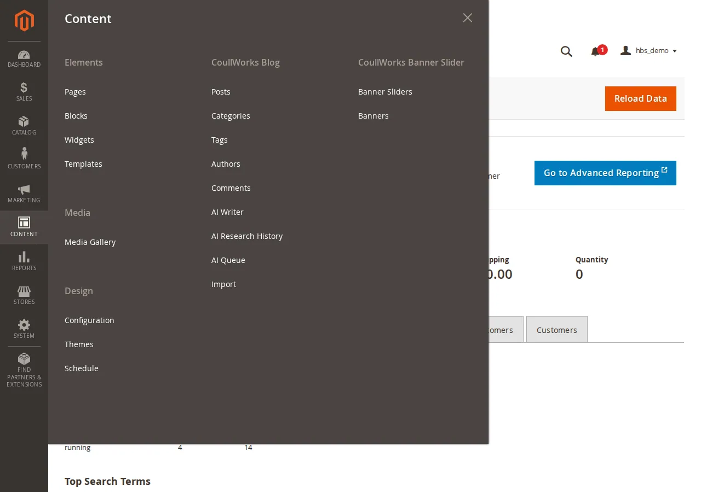

# Get started with Hero Banner Slider in five minutes

This takes about five minutes on a store that has the module [installed](install.md).

## 1. Find the menu

Open **Content** in the admin menu. The module adds **CoullWorks Banner Slider** with two entries, **Banners** and **Banner Sliders**.

*The module menu sits under Content. The top entry is a heading; Banners and Banner Sliders open the two grids.*

## 2. Check the module is on

Go to **Stores, Configuration, CoullWorks, Banner Slider**. **Enable** defaults to Yes. See [Configure](configure.md).

## 3. Create a banner

Open **Banners** and press **Add new Banners**. Set a name, upload a desktop image, optionally a phone image, switch **Hero Banner enabled** to Yes and save. Every field is explained in [Banners](banners.md).

## 4. Place it

Easiest is a widget on a CMS page. Open **Content, Pages**, edit a page, and use **Insert Widget** in the editor. Choose **Hero Banner (CoullWorks)**, pick your banner and save. Or use Page Builder: drag **Hero Banner** onto the stage. See [Widgets](widgets.md) and [Page Builder](page-builder.md).

## 5. Look at the storefront

*The banner with its overlay heading and copy at desktop width.*

*At 390 pixels wide the phone image is used and the overlay text scales down.*

If nothing appears, see [Troubleshooting](troubleshooting.md).
