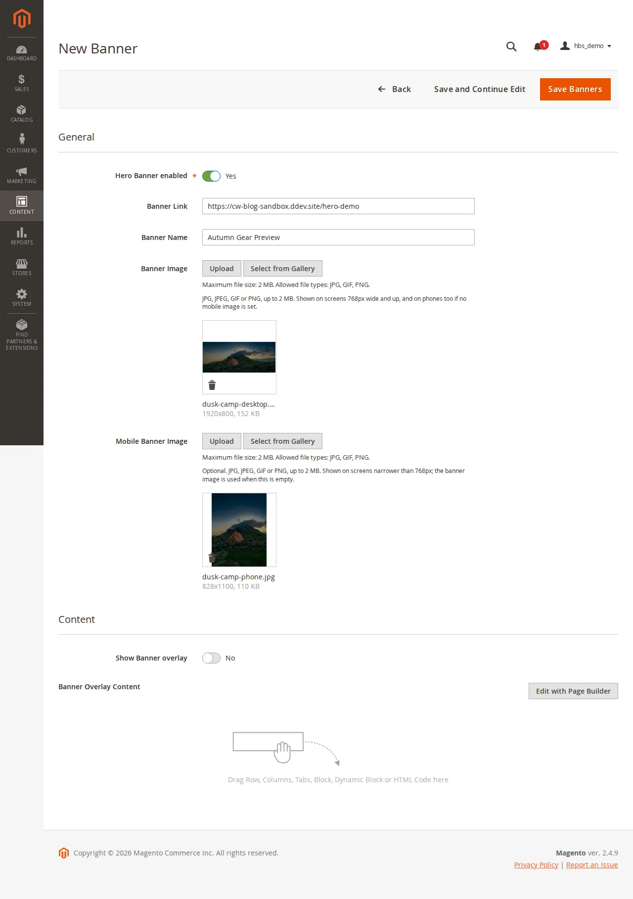
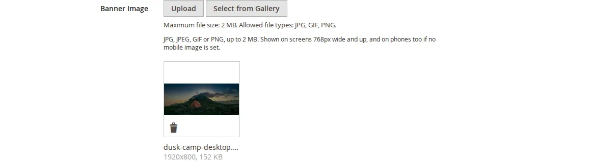
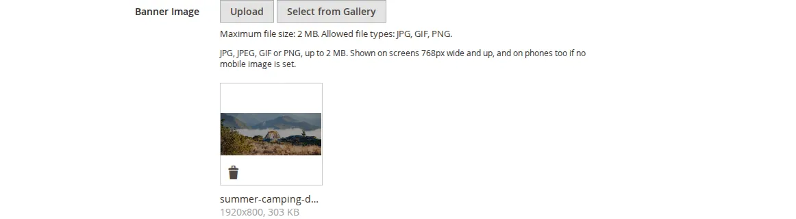

# Banner images: sizes, WebP and phone images

Image handling is automatic. There are no admin settings for WebP, quality, widths or eager and lazy loading.

## Uploading

On the [banner form](banners.md#the-banner-form) press **Upload** under **Banner Image** or **Mobile Banner Image**, or **Select from Gallery**. The file goes to a temporary folder first and is moved to its final place when you save the banner. Uploading needs the **Save Banner** [permission](permissions.md).

*Both images uploaded, with the file names and sizes shown.*

*The preview after an upload.*

## Allowed types and size

JPG, JPEG, GIF and PNG, up to 2 MB each. WebP and SVG uploads are not allowed. The WebP versions are made by the module. The form says this under each field.

*The rules under Banner Image.*

*The rules under Mobile Banner Image.*

## Where files are stored

On save the file moves to `media/banner/image/` and the banner stores the relative path `banner/image/<file>`.

## What happens on save

A new upload is moved from the temporary folder. An image you did not touch is kept. A form with no image field leaves the stored image alone. This avoids the media gallery errors some Magento 2.4.6 and later installs show when a saved image is moved a second time.

## Sizes

| Screen | Image used | Width |
|---|---|---|
| 768 pixels wide and up | The desktop image, as WebP, with the original format as fallback | 1920 |
| Under 768 pixels | The phone image, as WebP, with the original format as fallback | 828 |

If a banner has no phone image, the desktop image is used on phones too, scaled to 828 pixels. The images are served through a `<picture>` element, so a phone never downloads the desktop file. The sizes are fixed.

## WebP and the cache

The first request for a size makes the file and caches it under `media/banner/image/cache/`. Images are never enlarged, the aspect ratio is kept, and the quality is 82. WebP needs PHP GD with WebP support or Imagick. Without either, the original format is served. Upload an image about 1920 pixels wide, and a phone image around 828 pixels wide.

## Loading and LCP

The hero image loads eagerly with `fetchpriority="high"` and `decoding="async"`, because the banner is usually the largest thing on the page. In a slider the first slide loads the same way and the others lazy load.

*Desktop.*

*Phone.*

## What you cannot set

No WebP toggle, quality, width, LCP or lazy setting exists. Alt text is the banner's name. Put a good name on every banner.
