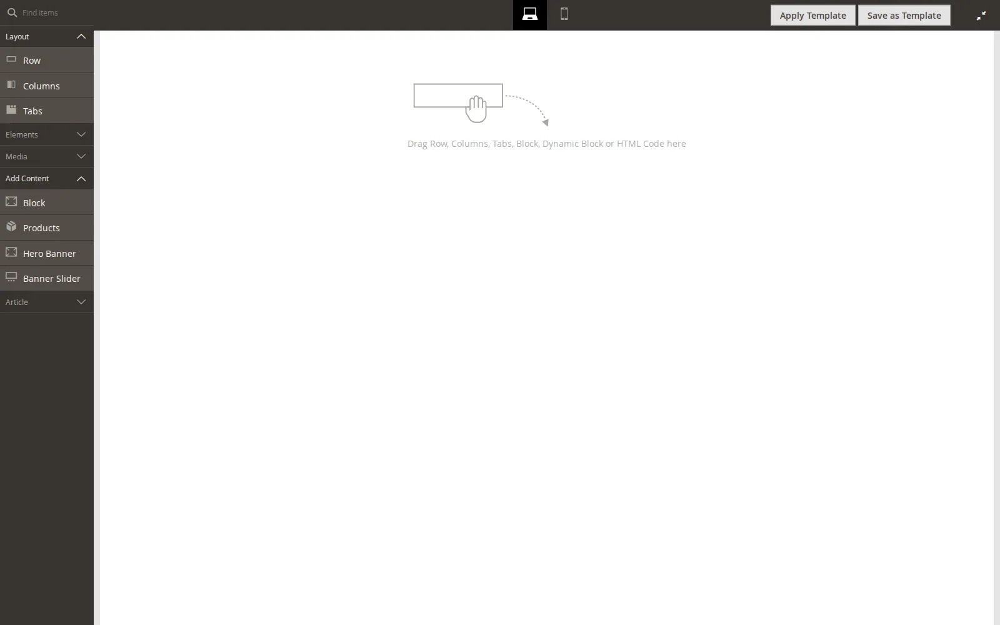
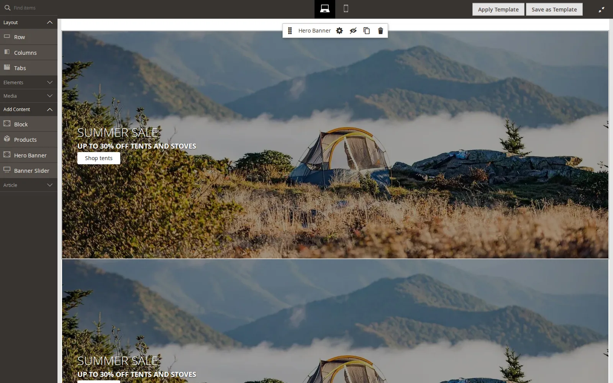
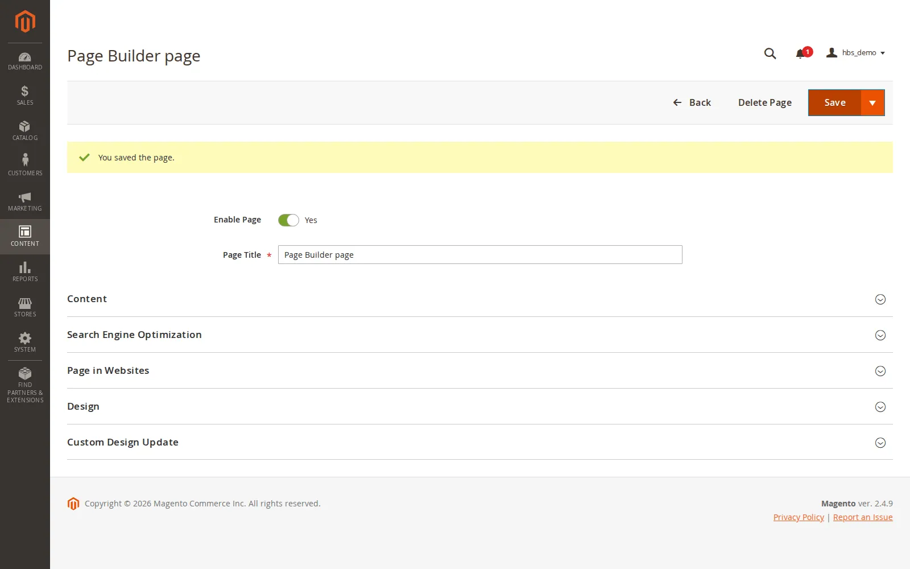
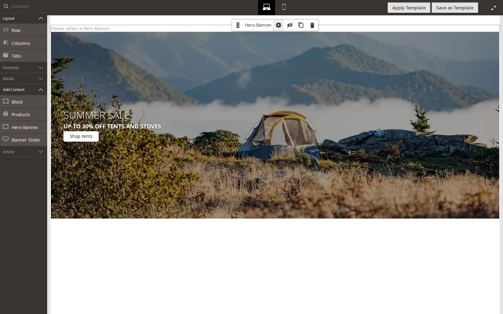
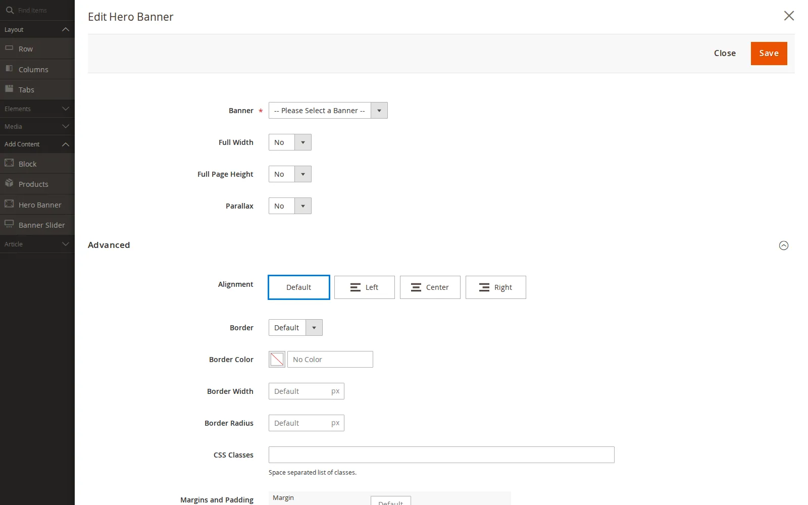
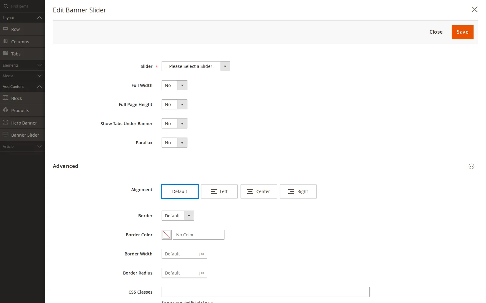
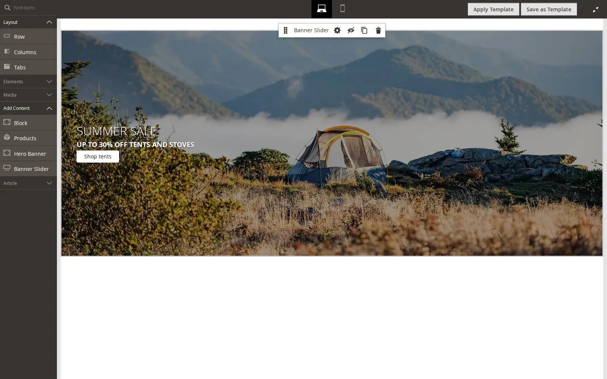

# Page Builder content types: Hero Banner and Banner Slider

The module adds two content types to Magento Page Builder. They use the same banners and sliders as the widgets, so create those first ([Banners](banners.md), [Sliders](sliders.md)).

## Find them in the panel

Edit a CMS page, a category description or a block with Page Builder. In the left panel, under **Add Content**, you will find **Hero Banner** and **Banner Slider**.

*The panel. Hero Banner and Banner Slider come after Block and Products.*

## Drop them on the stage

Drag a content type into a row or column. Here both are on one stage.

*A Hero Banner above a Banner Slider on the stage.*

## What is not a setting

The content types have only the settings listed below. There is no autoplay switch or speed, no arrows or dots option, no transition, loop or caption setting, no link target, no overlay position or colour, no per placement images and no WebP or LCP toggle. The slider behaviour is fixed, see [How it behaves](behaviour.md).

## Save and view

Save the page. The storefront shows the banner and slider in place, and at phone width they switch to the phone images.

*The page after Save.*

*The page on the storefront at 1280 pixels.*

*The same page at 390 pixels.*

When **Enable** is No in the [configuration](configure.md), the storefront shows neither. The stage preview still works.

## The Hero Banner content type

The content type is `coullworks_hero_banner`. It sits in **Add Content** in the left panel, and has one appearance.

*A Hero Banner on the stage, with its toolbar: move, settings, hide or show, duplicate and delete.*

Open the settings with the cog in the toolbar.

*The Hero Banner settings panel: the General fields, then the Advanced group.*

### Hero Banner: the toolbar and Hide / Show

The eye icon in the toolbar hides the content type on the storefront while keeping it in the page. It sets `display: none` on the wrapper. Click it again to show it.

*The hide and show icon sits between the cog and the duplicate button.*

### Hero Banner: the stage preview

On the stage the content type draws the chosen banner so you can see what you are placing. Until you choose one it shows a prompt. The preview redraws when you change a banner setting, but not for Advanced changes such as margins and borders, which only affect the wrapper.

*The preview. The overlay appears unstyled on the stage; it is styled on the storefront.*

### Hero Banner: Banner

Required. Pick the banner. The list starts with "-- Please Select a Banner --", and the content type shows a prompt on the stage until you choose one.

*Banner.*

*With a choice made.*

### Hero Banner: Full Width

Yes breaks the banner out to the full screen width.

*Full Width.*

### Hero Banner: Full Page Height

Yes makes the banner at least as tall as the screen.

*Full Page Height.*

### Hero Banner: Parallax

Yes applies the parallax effect to the image, at a fixed 500 pixel height.

*Parallax.*

### Hero Banner: Advanced settings

The Advanced group is the standard Page Builder group, shared with every content type. It changes the wrapper around the banner, not the banner itself.

#### Hero Banner: Alignment

Sets the text alignment of the content type wrapper: Default, Left, Center or Right. It affects overlay text that does not set its own alignment.

*Alignment.*

#### Hero Banner: Border

The border style of the wrapper: Default, None, Dotted, Dashed, Solid, Double, Groove, Ridge, Inset or Outset. Border Color, Width and Radius stay disabled until you choose a style.

*Border.*

#### Hero Banner: Border Color

The colour of the border, from a colour picker. Disabled while Border is Default or None.

*Border Color.*

#### Hero Banner: Border Width

The border width in pixels.

*Border Width.*

#### Hero Banner: Border Radius

The corner radius in pixels. It rounds the wrapper. The image inside is not clipped, so it suits banners with a visible border.

*Border Radius.*

#### Hero Banner: CSS Classes

A space separated list of extra classes added to the wrapper, so your theme can style this one banner.

*CSS Classes.*

#### Hero Banner: Margins and Padding

Margin and padding for each side, from minus 999 to 999 pixels, applied to the wrapper.

*Margins and Padding.*

## The Banner Slider content type

The content type is `coullworks_banner_slider`. It sits in **Add Content** in the left panel, and has one appearance.

*A Banner Slider on the stage, with its toolbar: move, settings, hide or show, duplicate and delete.*

Open the settings with the cog in the toolbar.

*The Banner Slider settings panel: the General fields, then the Advanced group.*

### Banner Slider: the toolbar and Hide / Show

The eye icon in the toolbar hides the content type on the storefront while keeping it in the page. It sets `display: none` on the wrapper. Click it again to show it.

*The hide and show icon sits between the cog and the duplicate button.*

### Banner Slider: the stage preview

On the stage the content type draws the chosen banner so you can see what you are placing. Until you choose one it shows a prompt. The preview redraws when you change a banner setting, but not for Advanced changes such as margins and borders, which only affect the wrapper.

*The preview. The overlay appears unstyled on the stage; it is styled on the storefront.*

### Banner Slider: Slider

Required. Pick the slider. The list starts with "-- Please Select a Slider --".

*Slider.*

*With a choice made.*

### Banner Slider: Full Width

Yes breaks the slider out to the full screen width.

*Full Width.*

### Banner Slider: Full Page Height

Yes makes the slider at least as tall as the screen.

*Full Page Height.*

### Banner Slider: Show Tabs Under Banner

Yes shows a strip of banner names under the slider and turns the arrows off.

*Show Tabs Under Banner.*

### Banner Slider: Parallax

Yes applies parallax to every slide image.

*Parallax.*

### Banner Slider: Advanced settings

The Advanced group is the standard Page Builder group, shared with every content type. It changes the wrapper around the banner, not the banner itself.

#### Banner Slider: Alignment

Sets the text alignment of the content type wrapper: Default, Left, Center or Right. It affects overlay text that does not set its own alignment.

*Alignment.*

#### Banner Slider: Border

The border style of the wrapper: Default, None, Dotted, Dashed, Solid, Double, Groove, Ridge, Inset or Outset. Border Color, Width and Radius stay disabled until you choose a style.

*Border.*

#### Banner Slider: Border Color

The colour of the border, from a colour picker. Disabled while Border is Default or None.

*Border Color.*

#### Banner Slider: Border Width

The border width in pixels.

*Border Width.*

#### Banner Slider: Border Radius

The corner radius in pixels. It rounds the wrapper. The image inside is not clipped, so it suits banners with a visible border.

*Border Radius.*

#### Banner Slider: CSS Classes

A space separated list of extra classes added to the wrapper, so your theme can style this one banner.

*CSS Classes.*

#### Banner Slider: Margins and Padding

Margin and padding for each side, from minus 999 to 999 pixels, applied to the wrapper.

*Margins and Padding.*
