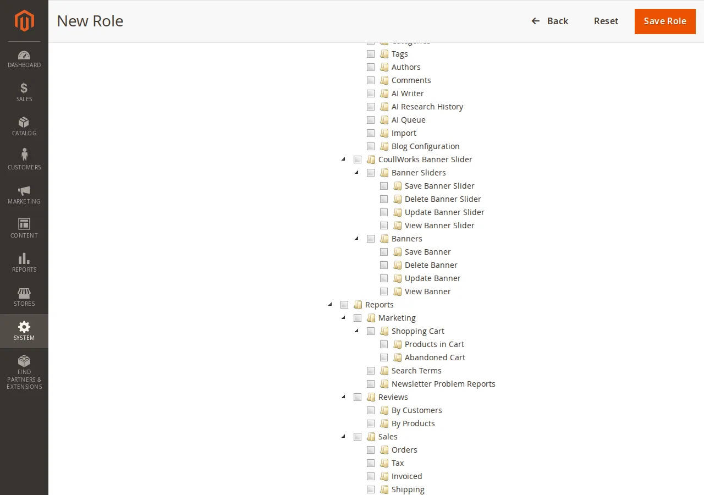
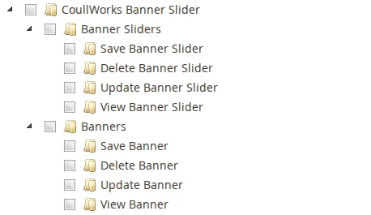
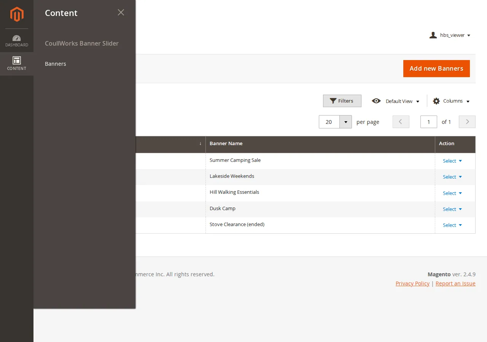
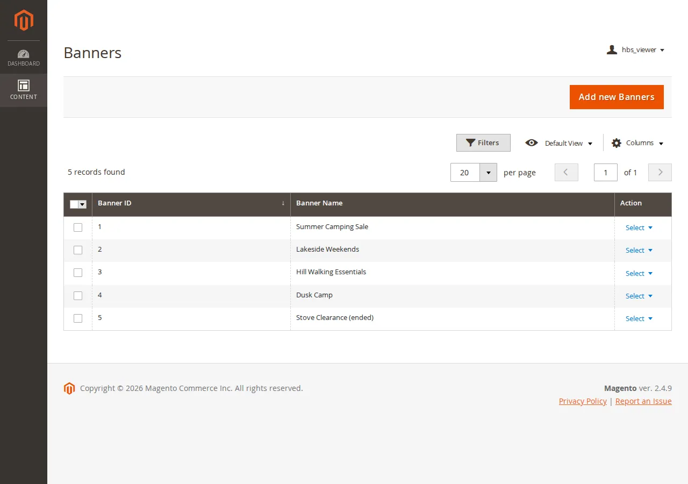
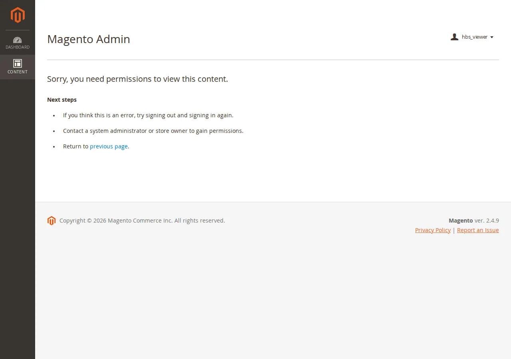

# Permissions and roles for Hero Banner Slider

From 2.1.0 every admin action is checked against its own permission. Before 2.1.0 only the top level was checked, so a role could do everything or nothing. **Roles that worked before need the new resources ticked** (see [Upgrade](upgrade.md)).

## The permission tree

Go to **System, Permissions, User Roles**, edit or add a role and open **Role Resources**. Set **Resource Access** to Custom. The module appears as **CoullWorks Banner Slider**.

*CoullWorks Banner Slider in the Role Resources list.*

*The tree: Banner Sliders and Banners, each with Save, Delete, Update and View.*

The top level, **CoullWorks Banner Slider**, is the parent of both groups.

## Banner Sliders

| Resource | Allows |
|---|---|
| Banner Sliders | The group. It guards the sliders grid data |
| View Banner Slider | Open the sliders grid and a slider form |
| Save Banner Slider | Create and save a slider |
| Update Banner Slider | Inline edit in the sliders grid |
| Delete Banner Slider | Delete a slider |

## Banners

| Resource | Allows |
|---|---|
| Banners | The group. It guards the banners grid data |
| View Banner | Open the banners grid and a banner form |
| Save Banner | Create and save a banner, and upload images |
| Update Banner | Inline edit in the banners grid |
| Delete Banner | Delete a banner |

## Image uploads

In 2.0.x any logged in admin could upload to the temporary folder. From 2.1.0 the upload needs **Save Banner**. A role without it is refused.

## The configuration page

**Stores, Settings, Configuration, Banner Slider** guards the [Enable setting](configure.md).

## A limited editor role, step by step

A read-only reviewer who may look at banners but not change them, and cannot see sliders or settings:

1. **System, Permissions, User Roles, Add New Role.** Name it, for example Banner reviewer.
2. In **Role Resources** choose Custom, tick **Banners** and only its child **View Banner**. Content and the module node are selected with it, so you do not tick them by hand. Leave Save, Update and Delete, **Banner Sliders** and the configuration resource unticked. To let the person edit as well, also tick Save and Update, and Delete if they may remove banners.
3. Save the role and assign it to a user.

What that user sees and can do:

*The menu shows Banners only.*

*They can open the Banners grid and look at banners.*

*Opening the Banner Sliders grid by its address is refused with a 403.*

*A role that has View but not Save is refused on a new banner.*
