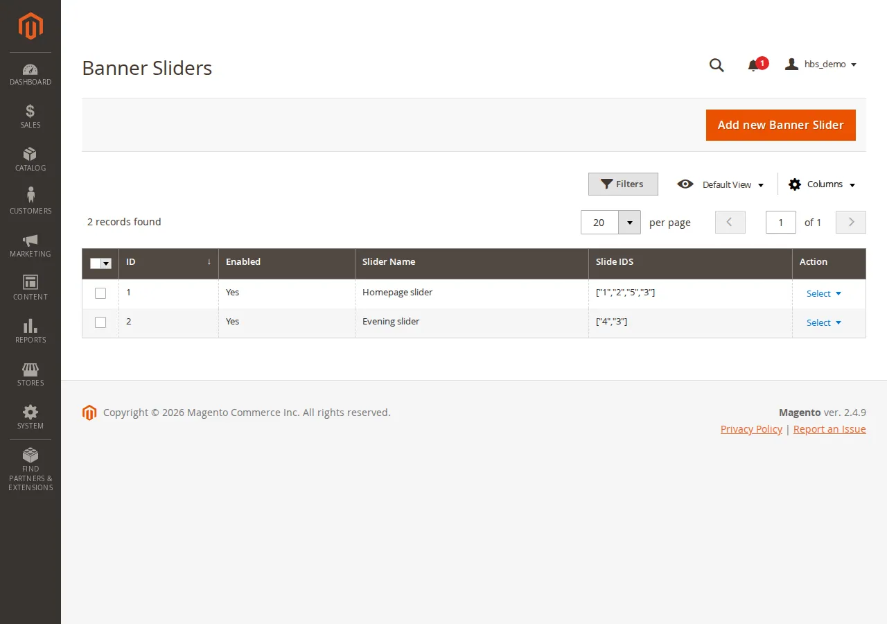
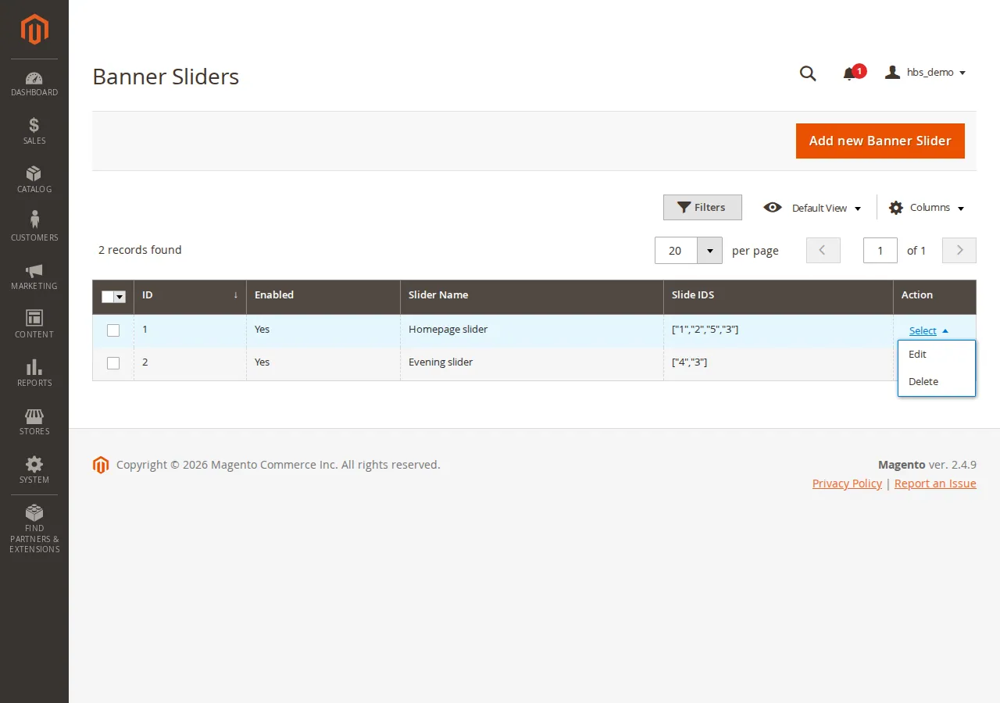
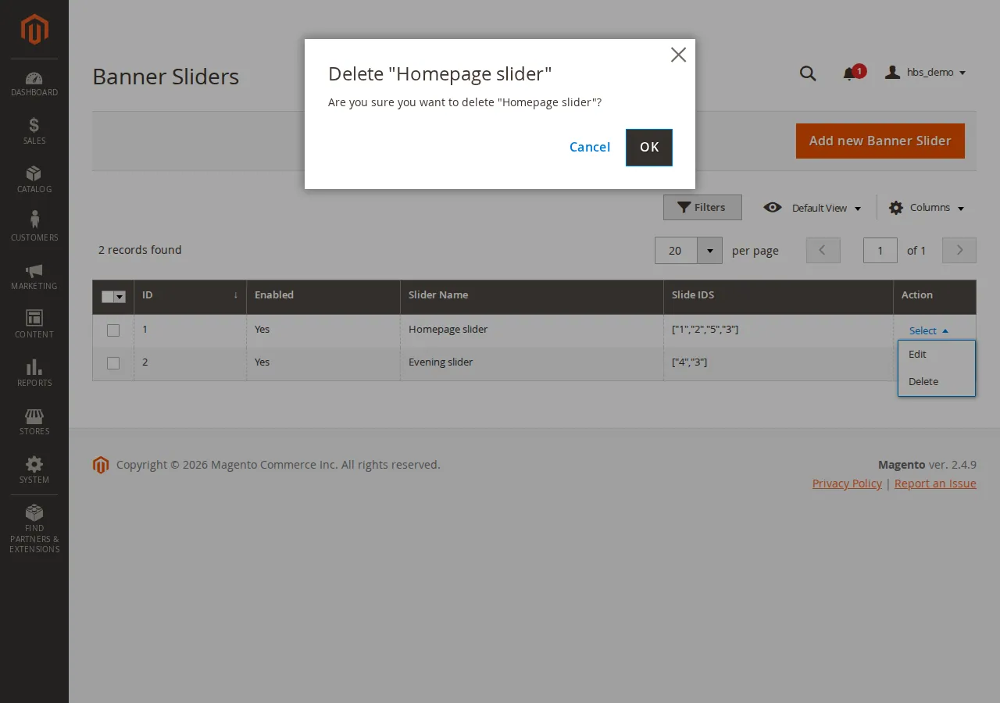
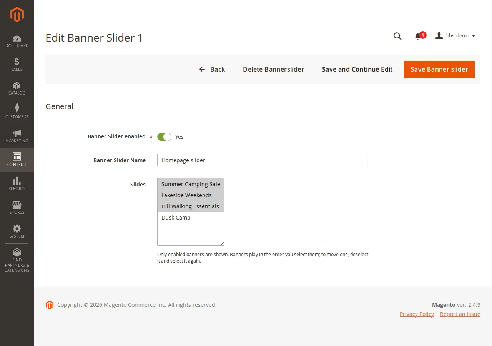
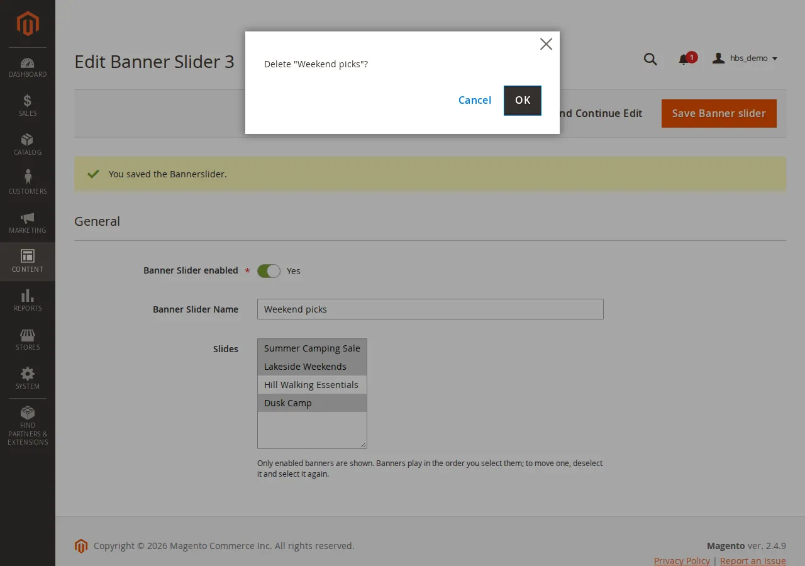
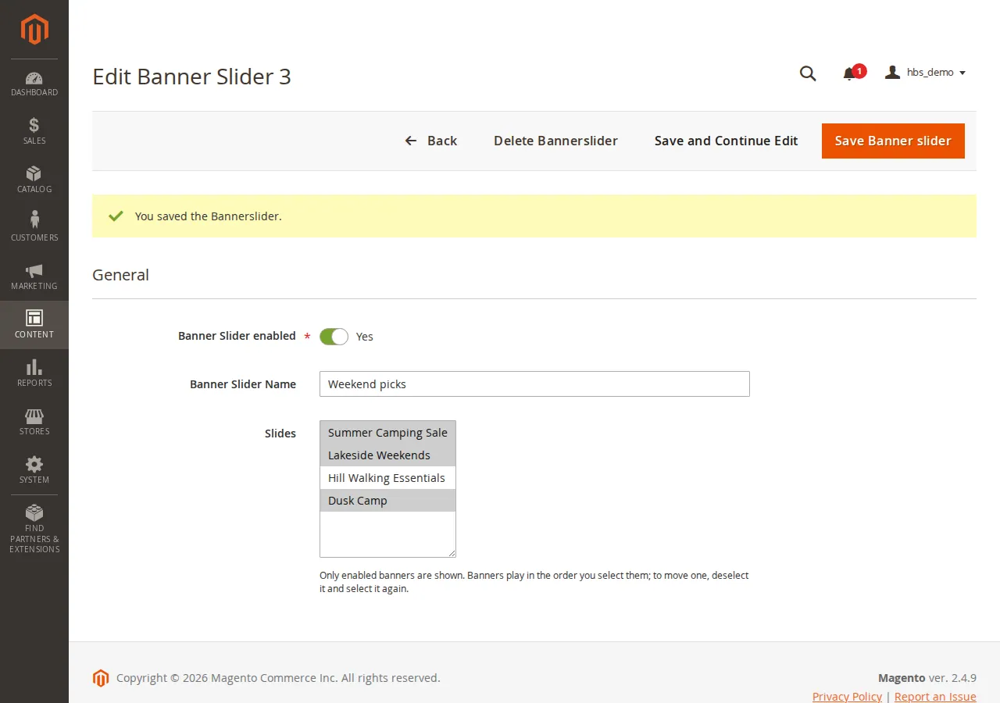
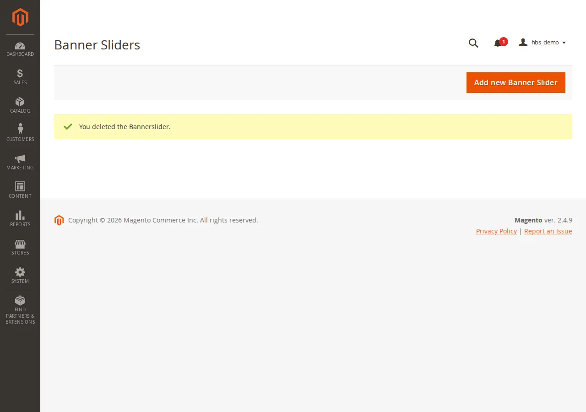

# Banner Sliders in Hero Banner Slider for Magento 2

A slider is a named, ordered list of banners. Open **Content, CoullWorks Banner Slider, Banner Sliders**. Create the [banners](banners.md) first.

## The Banner Sliders grid

*The Banner Sliders grid with ID, enabled, name, slides and actions.*

The toolbar is the standard sticky one: **Filters**, the **Default View** bookmark menu, **Columns** and paging.

## Add new slider

The orange button at the top opens an empty [slider form](#the-slider-form).

## Selection column

A row checkbox column. There are no mass actions.

## ID

The slider's number, sorted ascending by default, with a text filter. It is the value stored by widgets and Page Builder.

*The slider ID column.*

## Enabled

A Yes or No column showing whether the slider is switched on. In 2.0.x it was wrongly labelled "Slider Name".

## Slider Name

The name, with a text filter. It can be edited in place.

## Slide IDs

The ids of the banners in the slider, in play order, shown as a list of numbers. It can be filtered as text.

## Actions: edit and delete

*Edit and Delete in the row menu.*

*Deleting asks first and names the slider.*

Deleting a slider does not delete its banners. A page that still places the deleted slider shows nothing in its place.

## Inline edit

Click a row to change the name or the slide ids in the grid. Typing the slide ids by hand is easy to get wrong, so use the form to change slides.

## The slider form

*The slider form has one group, General, with enabled, name and slides.*

## Banner Slider enabled

Required. A slider set to No renders nothing wherever it is placed.

*Banner Slider enabled.*

## Banner Slider Name

Not required, but it is the label in the picker for widgets and Page Builder, so name it.

*Banner Slider Name.*

## Slides

A multiple select of all your banners. Hold Ctrl (Cmd on a Mac) and click to pick several. **Banners play in the order you select them.** To move one, deselect it and select it again. Disabled banners are skipped on the storefront.

*The slides list. Selected banners are shaded.*

*Summer Camping Sale, Lakeside Weekends and Dusk Camp selected, in that order.*

The list is stored as a short text field, so it holds about 40 to 50 banners.

## The buttons

| Button | What it does |
|---|---|
| **Back** | Returns to the grid |
| **Delete Bannerslider** | Only on an existing slider. Asks first, naming the slider |
| **Save and Continue Edit** | Saves and stays on the form |
| **Save Banner slider** | Saves and returns to the grid |

*Deleting from the form asks first and names the slider.*

## Messages

| Message | When |
|---|---|
| You saved the Bannerslider. | A save worked |
| You deleted the Bannerslider. | A delete worked |
| We can't find a Bannerslider to delete. | The slider was already gone |

*The save message.*

*The delete message.*

## Fields that no longer exist

Versions before 2.1.0 had an unused `full_width` column in both tables with no field in the form. Release 2.1.0 removed it. Full width is set where you place a banner or slider, not on the banner or slider itself.
