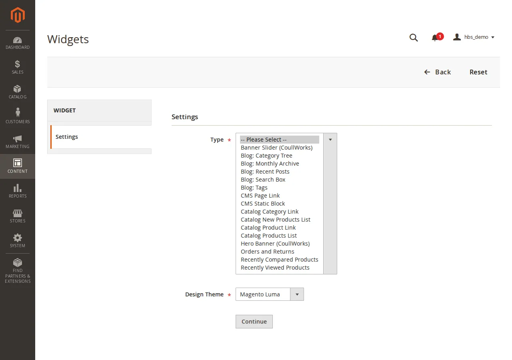
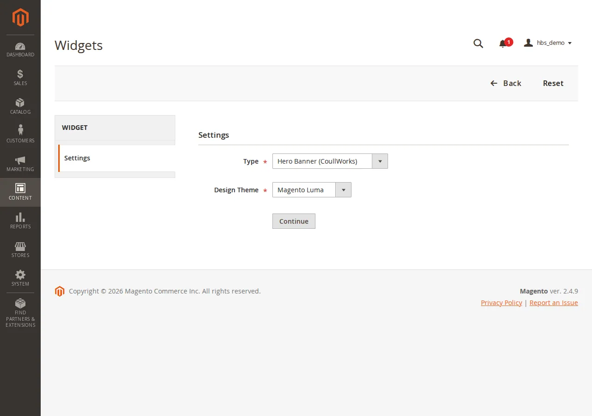
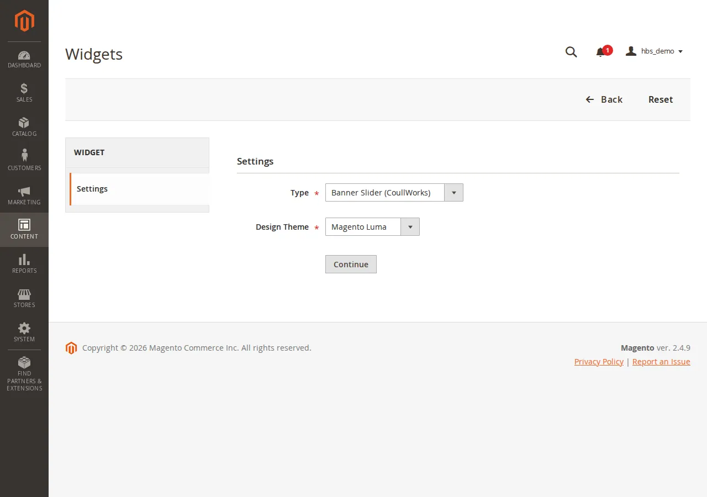
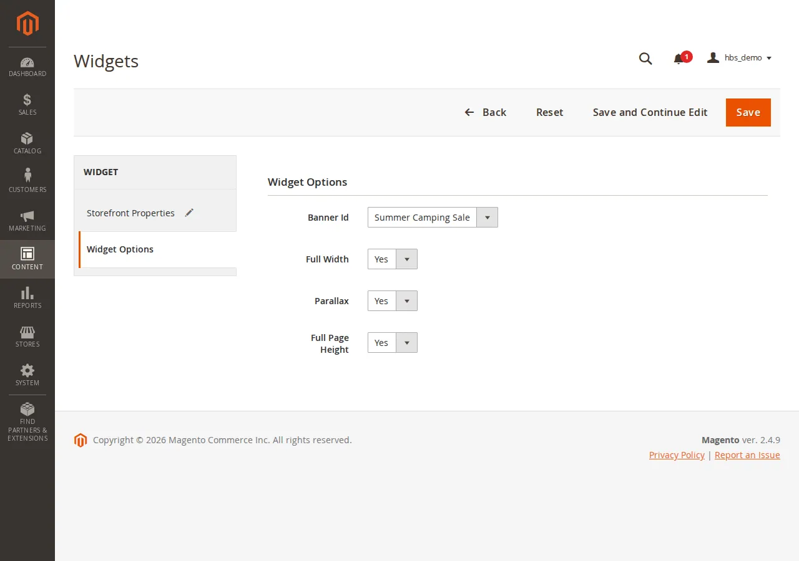
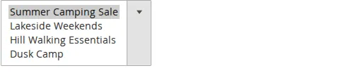
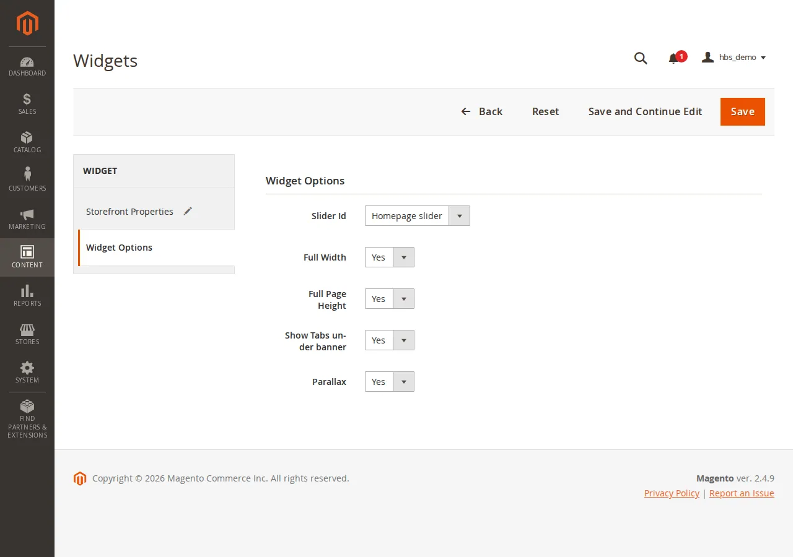
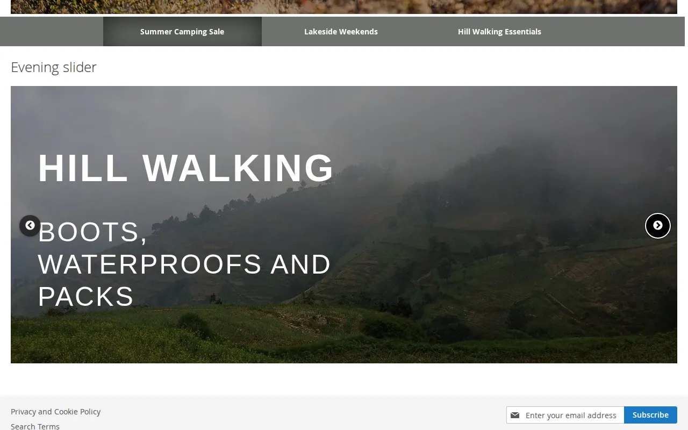
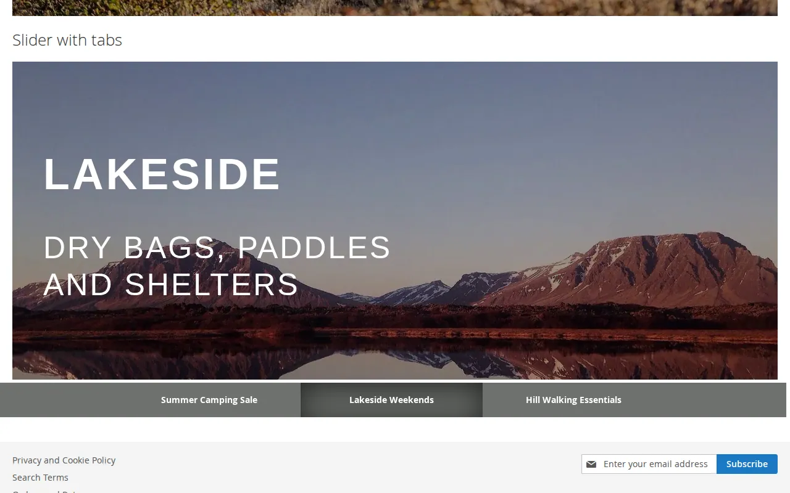

# The Hero Banner and Banner Slider widgets for Magento 2

There are two widgets, **Hero Banner (CoullWorks)** and **Banner Slider (CoullWorks)**. They are the classic way to place banners, and they work anywhere Magento lets you insert a widget. Page Builder has its own [content types](page-builder.md) for the same banners.

Both widgets render nothing when **Enable** is No in the [configuration](configure.md).

## Choosing a widget

In **Content, Elements, Widgets** press **Add Widget**, or press **Insert Widget** in any editor. The **Type** list holds both.



*The widget picker in the editor. Both are labelled (CoullWorks) so they stand apart from other modules.*



*Add Widget with the Hero Banner type chosen.*



*Add Widget with the Banner Slider type chosen.*

## Hero Banner options



*The four options of the Hero Banner widget.*

### Banner Id

Pick the banner to show. The list shows every banner by name, including disabled ones. A disabled banner shows nothing on the page.


*Banner Id.*



*The list is filled with your banners, by name.*

### Full Width

Yes breaks the banner out of the page column to the full width of the screen. The overlay text stays inside a 1280 pixel container.

### Parallax

Yes makes the image move slower than the page as it scrolls. A parallax banner is 500 pixels high.


*Scrolled: the image has shifted against the text.*

### Full Page Height

Yes makes the banner at least as tall as the screen.

## Banner Slider options



*The five options of the Banner Slider widget.*



*A slider without tabs shows left and right arrows. The screenshot is of a page with two sliders: the tabs strip of the first is at the top, the slider below it has arrows.*

The arrows sit inside the slider on a dark round button with a white arrow, 40 pixels wide (36 on a phone), so they read on a light page and over dark photographs. They have a hover state and a visible focus ring for keyboard users.


### Slider Id

Pick the slider. The list shows your sliders by name.


*Slider Id.*


*The list of sliders.*

### Full Width

As for the hero: break out to the full screen width.

### Full Page Height

As for the hero: at least as tall as the screen.

### Show Tabs under banner

Yes adds a strip under the slider with each slide's banner name. Clicking a tab shows that slide. With tabs on, the arrows are turned off.



*The tabs strip under the slider at desktop width.*


*At 390 pixels wide.*

### Parallax

Yes applies the parallax effect to every slide's image. Each slide is 500 pixels high.

## Place a widget on a CMS page

1. Go to **Content, Pages**, edit the page and open **Content**.
2. In the editor press **Insert Widget**.
3. Choose **Hero Banner (CoullWorks)** or **Banner Slider (CoullWorks)**, set the options and press **Insert Widget**.
4. Save the page.

## Place a widget in a category description

Open **Catalog, Categories**, choose the category, open **Content** and use **Insert Widget** in the Description editor in the same way. Turn on **Display Mode** that shows the description, and the banner appears above the products.

## Place a widget as a layout widget

In **Content, Elements, Widgets**, press **Add Widget**, choose the type and your theme, then on **Storefront Properties** give it a title and store views and add a **Layout Update**. On **Widget Options** set the options.

## The widget directive and layout XML

The editor inserts a directive you can also type in a static block or CMS page:

```text
{{widget type="CoullWorks\BannerSlider\Block\Widget\HeroBanner" banner_id="1" full_width="1" is_parallax="0" full_height="0"}}
{{widget type="CoullWorks\BannerSlider\Block\Widget\BannerSlider" slider_id="1" show_tabs="1"}}
```

In layout XML use a `<block class="CoullWorks\BannerSlider\Block\Widget\BannerSlider">` with the same parameters as `<argument>` entries. Yes is `1` and No is `0`.
